# Stroke előrejelzése egészségügyi adatokból

**Baseline (logisztikus regresszió) és Random Forest statisztikai összehasonlítása**

*Mesterséges intelligencia adatelemzés (MSc) – féléves projekt · Jánosi Benedek · 2026. november*

## Röviden

| | |
|---|---|
| **Feladat** | Bináris osztályozás: volt-e stroke (5 110 páciens, 10 jellemző, 4,9% pozitív eset) |
| **Adat** | [Stroke Prediction Dataset](https://www.kaggle.com/datasets/fedesoriano/stroke-prediction-dataset) (Kaggle, fedesoriano) |
| **Módszer** | Szivárgásmentes scikit-learn Pipeline saját transzformer-osztályokkal, rétegzett 5-fold CV, `GridSearchCV` |
| **Összehasonlítás** | Páros bootstrap CI, 5×2cv t- és F-próba, McNemar-próba |
| **Eredmény** | A teszthalmazon a két modell ROC-AUC-ja gyakorlatilag azonos (0,835 vs. 0,833), a különbség nem szignifikáns |
| **Javaslat** | Logisztikus regresszió: egyszerűbb, értelmezhető, és a 0,5-ös küszöbnél több stroke-ot talál meg |

A teljes elemzés, a kóddal és az értelmezésekkel együtt, a [`projekt.ipynb`](projekt.ipynb) notebookban található.

**Dokumentumok:**
- [Projektdokumentáció (PDF)](docs/Janosi_Benedek_stroke_projekt.pdf): a lefuttatott notebook a forráskóddal együtt.
- [Bemutató diasor (PDF)](docs/Stroke-elorejelzes_bemutato.pdf): a szóbeli bemutató 13 diája és 2 függelékdia.

## Fő eredmények

| | Logisztikus regresszió | Random Forest |
|---|---|---|
| CV ROC-AUC (5-fold, 95% CI) | 0,851 [0,820; 0,883] | 0,846 [0,810; 0,882] |
| Teszt ROC-AUC (bootstrap 95% CI) | 0,835 [0,776; 0,889] | 0,833 [0,773; 0,889] |
| Teszt PR-AUC (véletlen szint: 0,049) | 0,230 | 0,237 |
| Recall (0,5-ös küszöb) | 0,84 (42 / 50) | 0,76 (38 / 50) |
| Specificitás | 0,74 | 0,81 |
| Téves riasztás (FP) | 253 | 184 |

| Statisztikai összehasonlítás (RF − LR) | Eredmény | Következtetés |
|---|---|---|
| Páros bootstrap, Δ ROC-AUC (B = 2000) | −0,002 [−0,018; +0,016] | a CI tartalmazza a 0-t |
| 5×2cv t-próba (Dietterich) | t = −1,68, p = 0,15 | nem szignifikáns |
| 5×2cv combined F-próba (Alpaydin) | F = 1,46, p = 0,36 | nem szignifikáns |
| McNemar (0,5-ös küszöb) | χ² = 47,1, p ≈ 7·10⁻¹² | eltérő döntési pont: az RF 69-cel kevesebb téves riasztást, de 4-gyel több kimaradt stroke-ot ad |

**Jellemzőfontosság:** mindkét modell túlnyomórészt az életkorra támaszkodik (permutation importance: az `age` keverése 0,31, ill. 0,26 ROC-AUC-csökkenést okoz). A hiányzó BMI esélyhányadosa 3,24: a hiány nem véletlen, ezért külön kategóriaként is megtartottuk.

## Ábrák

Minden ábrát a notebook generál a `results/figures/` mappába.

| | |
|---|---|
| 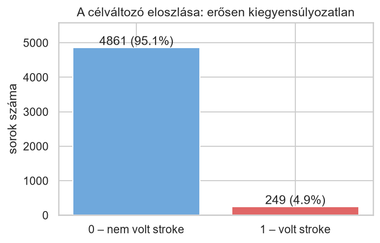 | 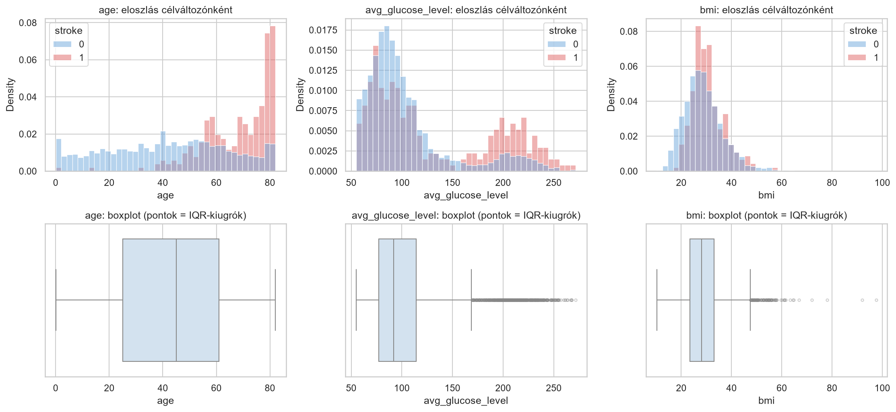 |
| **1.** A célváltozó: 4,9% stroke | **2.** Numerikus eloszlások és IQR-kiugrók |
| 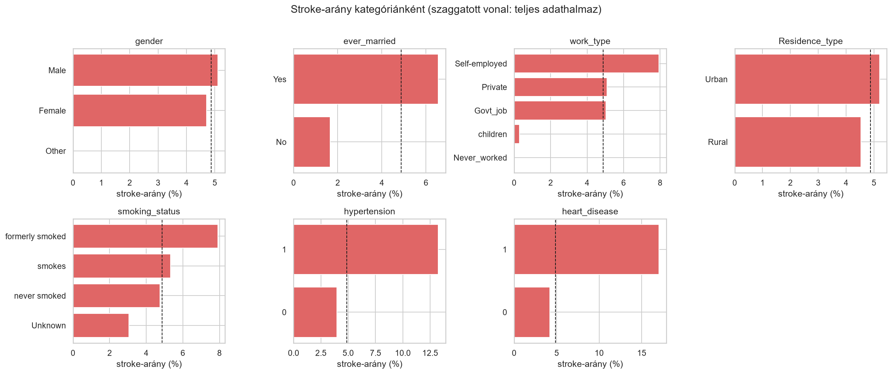 | 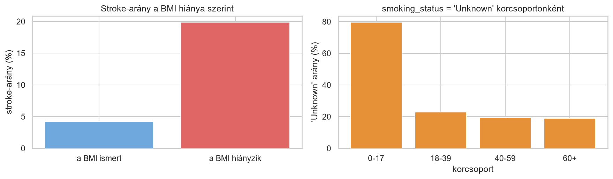 |
| **3.** Stroke-arány kategóriánként | **4.** A hiányzó BMI és az „Unknown” dohányzás |
| 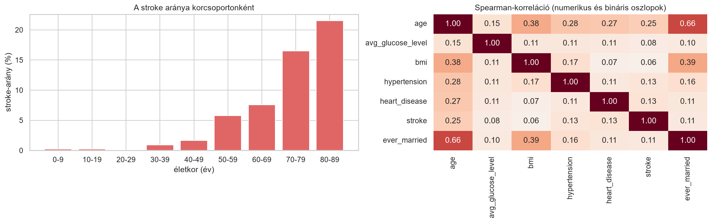 | 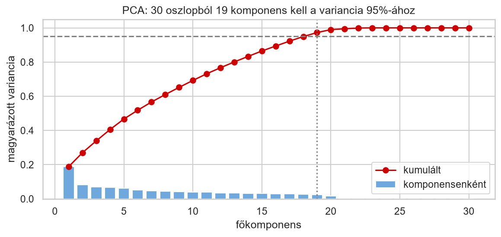 |
| **5.** Stroke-arány korcsoportonként, Spearman-korreláció | **6.** PCA: 19 komponens kell a variancia 95%-ához |
| 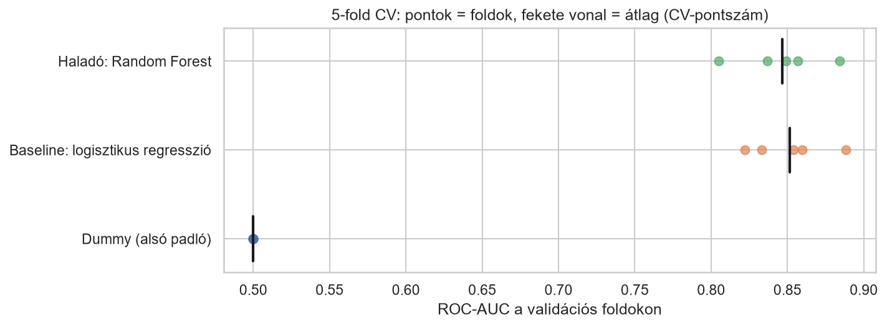 | 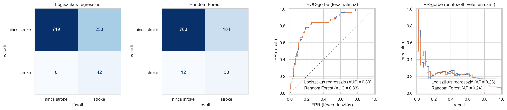 |
| **7.** ROC-AUC az 5 CV-foldon | **8.** Tévesztési mátrixok, ROC- és PR-görbe a teszten |
| 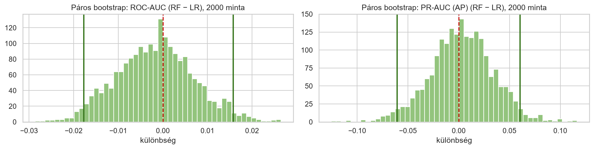 | 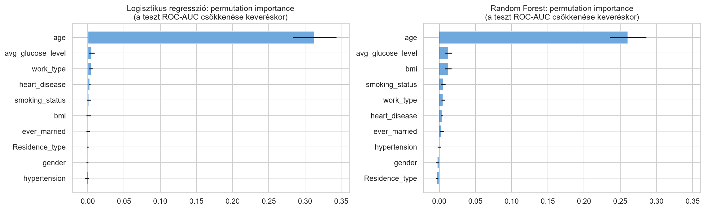 |
| **9.** A különbség (RF − LR) bootstrap-eloszlása | **10.** Permutation importance |
| 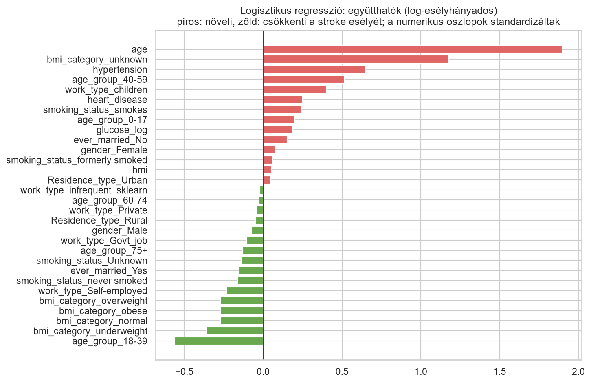 | |
| **11.** A logisztikus regresszió együtthatói | |

## A repó felépítése

```
stroke-prediction-ml/
├── projekt.ipynb          # a teljes elemzés (Run All)
├── requirements.txt       # a rögzített csomagverziók
├── docs/                  # a projektdokumentáció és a bemutató PDF-ben
├── data/                  # ide kerül a letöltött CSV (nem része a repónak)
└── results/
    ├── metrics.json       # a fő számok gépileg olvasható formában
    └── figures/           # a 11 ábra (PNG)
```

## Futtatás

1. **Környezet** (Python 3.12):

   ```bash
   conda create -n stroke-ml python=3.12 -y
   conda activate stroke-ml
   pip install -r requirements.txt
   ```

2. **Adat:** töltsd le a `healthcare-dataset-stroke-data.csv` fájlt a [Kaggle-oldalról](https://www.kaggle.com/datasets/fedesoriano/stroke-prediction-dataset), és tedd a `data/` mappába. Az adat nem része a repónak; a felhasználási feltételek a Kaggle-oldal *License* rovatában olvashatók.

3. **Futtatás:** nyisd meg a `projekt.ipynb`-t VS Code-ban vagy Jupyterben, válaszd a `stroke-ml` kernelt, és futtasd végig (*Run All*). A gép sebességétől függően néhány percig tart. Az ábrák és a `metrics.json` újragenerálódnak.

## Reprodukálhatóság

- Minden véletlen lépés (felosztás, CV, Random Forest, bootstrap) ugyanazt a `SEED = 42` értéket használja.
- A csomagverziókat a `requirements.txt` rögzíti. A notebook utolsó cellája kiírja a ténylegesen használt verziókat: numpy 2.5.5, pandas 3.1.1, scipy 1.18.1, scikit-learn 1.9.1, matplotlib 3.11.2, seaborn 0.13.2.
- Két különböző gépen (Windows, Python 3.12 és Linux, Python 3.13) futtatva a `metrics.json` értékei legfeljebb 2·10⁻¹⁵-tel térnek el egymástól.

## Korlátok

- A jellemzőfontosság nem oksági kapcsolat, és a korrelált jellemzők (főleg az életkorral összefüggők) között megoszlik.
- A teszthalmazban csak 50 stroke-os eset van, ezért a konfidenciaintervallumok szélesek.
- Az adat egyetlen, ismeretlen gyűjtési körülményű forrásból származik; nem ismert, hogy a mérések a stroke előtt vagy után készültek.
- A `class_weight` miatt a jósolt valószínűségek nem kalibráltak, így kockázatbecslésre csak kalibráció után használhatók.
